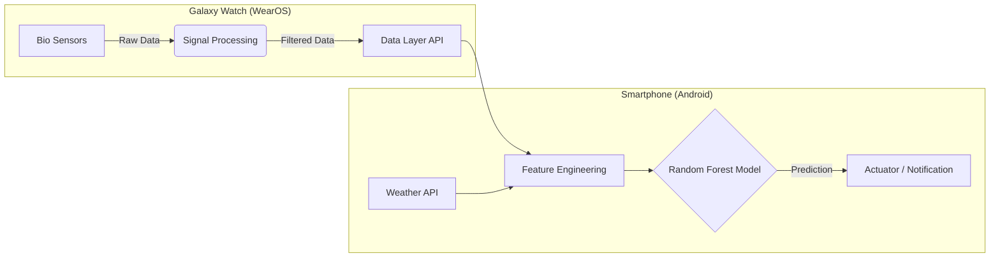

# Smart-Temperature-Adjustment-System-via-Random-Forest

## Project Overview (프로젝트 개요)

이 프로젝트는 사용자의 생체 신호(심박수, 활동량)와 환경 데이터를 실시간으로 분석하여, 실내 에어컨 온도를 사용자에게 최적화된 상태로 제어(또는 제안)하는 개인화된 스마트 온도 조절 시스템입니다.
단순한 제어를 넘어 신호 처리(Signal Processing) 기법을 통한 데이터 전처리와 머신러닝(Random Forest)을 결합하여 에너지 효율과 사용자 만족도를 동시에 달성하는 것을 목표로 합니다.

## Project Goal (프로젝트 목표)
 - 웨어러블(Galaxy Watch) 기반의 유동적 시스템으로 고도화
 - Human-Centric Control: 단순한 실내 온도 유지가 아닌, 사용자의 '체감 온도'와 '활동 상태'를 반영한 능동적 제어
 - Engineering Depth: 신호 처리 이론을 적용한 노이즈 캔슬링 및 데이터 효율화

## System Architecture (시스템 구조)


1. Data Collection (WearOS)
   Heart Rate: 광혈류 측정 센서(PPG)를 통해 실시간 심박수 수집
   Activity: 가속도 센서(Accelerometer)를 통해 사용자의 활동 상태(휴식, 작업, 운동 등) 감지
2. Decision Making
   수집된 생체데이터와 실내환경 데이터 결합
   Random Forest 알고리즘을 활용하여 사용자의 '쾌적(Comfort)' 여부를 판단하고 목표 온도 도출

## Technical Highlights
1. Low-Pass Filtering (LPF) & Convolution
WearOS 센서 특성상 움직임에 의한 노이즈(Motion Artifact)가 발생할 수 있습니다. 이를 제거하기 위해 이산 시간(Discrete-time) 영역에서 **이동 평균 필터(Moving Average Filter)**를 적용했습니다. 순간적인 센서 튀는 값(Impulse noise)을 제거하여 머신러닝 모델의 오작동을 방지합니다.

2. Sampling Theorem & Anti-Aliasing
배터리 효율과 정보의 정확성 사이의 트레이드오프를 고려하여 나이퀴스트 이론(Nyquist Theorem)에 기반한 최적의 샘플링 주기를 설정했습니다. 체온 및 심박의 변화 속도(Frequency)를 고려하여 데이터 손실(Aliasing) 없이 배터리 소모를 최소화하는 주기를 도출했습니다.

3. Frequency Domain Analysis (FFT)
가속도 센서(Accelerometer)의 시계열 데이터를 **고속 푸리에 변환(FFT)**하여 주파수 도메인으로 변환합니다. 이를 통해 단순한 움직임의 크기가 아닌, 움직임의 주기성을 분석하여 걷기, 타이핑, 휴식 등의 활동 패턴을 정교하게 분류합니다.

## Tech Stacks
### Mobile & Wearable


### Data Science & AI


### Tools & Environment


## Getting Started
### Prerequisites
 - Android Studio Koala or newer
 - Galaxy Watch 4 or newer (WearOS 3.0+)
 - Android Smartphone (Android 11+)

### Installation
1. Clone the repository
```Bash
git clone https://github.com/your-username/Smart-Temperature-Adjustment-System-via-Random-Forest.git
```
2. Open the project in Android Studio.
3. Sync Gradle and run the wear module on your watch/emulator.
4. Run the mobile module on your phone.

## Background
학교나 공공기관에서는 중앙 제어를 통해 에너지를 절약하지만, 이는 개별 사용자의 컨디션을 반영하지 못해 불쾌감을 유발하거나 효율이 떨어지는 문제가 있습니다. 본 프로젝트는 "에너지 절약"과 "사용자 만족도(Thermal Comfort)"라는 두 가지 상충되는 목표를 머신러닝을 통해 최적화하는 알고리즘을 제안합니다.

## Future Works
 - On-device Training 구현 (사용자 피드백을 실시간으로 학습)
 - Samsung SmartThings API 연동을 통한 실제 가전 제어
 - 다중 사용자 환경에서의 투표 기반 온도 제어 알고리즘 (Consensus Algorithm)
